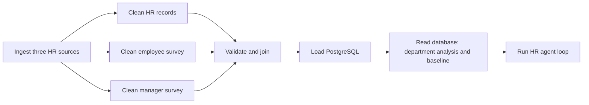
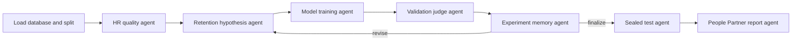

# Week 11 Data Engineering Assignment: People Analytics Lab

For this assignment, I built an original employee-data pipeline and bounded research loop, applying the orchestration ideas from this week's Airflow/LangGraph demo. The employee-data theme is a way to practice data engineering with a subject I am interested in. My analysis question is: **How do survey responses and work-history characteristics relate to the attrition labels in this teaching dataset, and can a model distinguish those labels better than a naive benchmark?**

This is a course exercise using a public teaching dataset, not an analysis of any employer or a validated system for predicting future employee attrition. The source does not establish a reliable prediction snapshot or future outcome window. Findings are associations and questions for follow-up, not causal effects of HR interventions.

## Run

Prerequisite: Docker Desktop running. From this directory:

```bash
docker compose up --build -d
docker compose ps
```

Allow initialization to finish. Open Airflow at http://localhost:8090 (username `student`, password `classroom`). Find `people_analytics_daily`, unpause it, and trigger a run. Open Graph view to watch the independent cleaning tasks and downstream tasks execute. Refresh the dashboard at http://localhost:8502 when the DAG succeeds.

The dashboard's **Live agent workflow** tab shows the actual compiled LangGraph and saved evaluation results. Its **Run HR research loop** button streams a new execution and highlights each completed node. The scheduled DAG also runs this loop automatically after the baseline.

```bash
# Verify source integrity, split isolation, and loop termination.
docker compose exec scheduler python -m pytest -q

# Independently run Part 2 after the database has been populated.
docker compose exec scheduler python -m hr_pipeline.agents

# Check DAG parsing.
docker compose exec scheduler airflow dags list-import-errors

# Stop this project; database and logs remain in named volumes.
docker compose down
```

Ports 8090 and 8502 avoid the classroom demo's ports. PostgreSQL is internal to this Compose project. Credentials are local classroom defaults; this configuration is intended for a laptop. Airflow 2.10.4 / Python 3.11 match the provided classroom demo.

## Data sources and transformations

Original publisher: [Vijay Choudhary, HR Analytics Case Study](https://www.kaggle.com/datasets/vjchoudhary7/hr-analytics-case-study).

| Independently supplied table | Rows | Content |
|---|---:|---|
| `general_data.csv` | 4,410 | Employee ID, attrition label, department, work history and other HR attributes |
| `employee_survey_data.csv` | 4,410 | Employee ID, environment satisfaction, job satisfaction, work-life balance |
| `manager_survey_data.csv` | 4,410 | Employee ID, involvement and performance ratings |

Files are downloaded directly from the original Kaggle dataset API, not copied from another student's solution. `hr_pipeline/data.py` caches them locally and records SHA-256 checksums in `artifacts/source_manifest.json`. The publisher API reports the license as **Unknown**, so raw data is excluded from Git; obtain it from the publisher rather than redistributing it with this code. This project makes no claim that the case represents verified real employees.

All tables must have non-null, unique EmployeeIDs and identical employee-ID sets. String whitespace is trimmed; survey ratings are checked against their 1–4 scales; Yes/No attrition is converted to 1/0; constant administrative columns are removed. The three tables are joined with validated one-to-one joins. Missing values remain visible in the cleaned database, then are imputed inside the modeling pipeline using training data only. This avoids using validation/test information to choose imputation values.

The merged snapshot is transactionally replaced in PostgreSQL table `hr.employee_analytics`, with EmployeeID as its primary key. Re-running a load replaces the snapshot rather than appending duplicate employees. This is snapshot ingestion, not change-data capture. The source is static: scheduling demonstrates orchestration, not new daily observations.

## Part 1: scheduled Airflow DAG



- **Schedule:** daily at 06:00 America/Toronto, cron `0 6 * * *`; timezone-aware start date; `catchup=False` avoids historical backfills. Scheduled runs require the DAG to be unpaused and the scheduler to remain running. Manual triggering is useful for initial verification.
- **Parallelism:** all three cleaning tasks depend only on ingestion, so LocalExecutor can run them concurrently. The merge waits for all three. Three task slots per DAG permit overlap; actual overlap depends on available resources.
- **Failures:** tasks retry twice, 20 seconds apart. Invalid IDs and ratings fail visibly rather than silently dropping rows.
- **Data passing:** XCom carries paths or small summaries. CSV rows are stored in run-specific staging files and the database.
- **Analysis:** the baseline and department summary explicitly query PostgreSQL after loading. The dashboard also reads PostgreSQL.

## Part 2: original agent graph and loop



Changes from the class workflow:

1. Read the merged HR dataset from PostgreSQL.
2. Add an HR quality gate for repeated-profile split isolation and excluded model inputs.
3. Use a retention-specific experiment planner and average precision as the selection metric.
4. Give the judge explicit validation-goal and trial-budget stopping rules; memory retains every trial, including the final one.
5. Add a People Partner report agent that explains how to interpret the evidence and its limits.
6. Render the actual compiled graph in the dashboard, including live execution highlights.

The loop runs at most three training trials. It starts with class-balanced logistic regression, compares a shallow forest, and can try a deeper forest. A later trial lowers its classification threshold only if the best validation recall is below 0.5. The judge finalizes at validation average precision ≥0.40 after at least two trials, or at the trial limit. The threshold is an exercise design choice, not a production acceptance standard. Failed trials are recorded; later iterations continue within the same budget. If every trial fails, the final stage fails explicitly.

**Default mode is rules-based coordination.** These nodes have distinct roles and shared state, but rules mode does not claim to use LLM reasoning. Like the classroom fallback, it works without an API key. Optional LLM planning is implemented: copy `.env.example` to `.env`, set `OPENROUTER_API_KEY` and `OPENROUTER_MODEL`, then recreate the services. Only aggregate validation history is sent. Model family and numerical settings are validated against bounds, and API/parse failures are explicitly labeled `rules_fallback`. Live LLM mode requires a user-provided key and has not been established by a rules-mode run.

## Evaluation and people analytics interpretation

The 4,410 rows include only 1,470 distinct profiles across non-missing general HR predictors. A fixed profile fingerprint groups repeated profiles, excluding employee ID, outcome, and HR fields with missing values. GroupShuffleSplit keeps those groups disjoint across train/validation/test (approximately 60/20/20). This prevents near-identical repeated records leaking across evaluation splits. It does not establish that the groups are verified person identities, and repeated records still limit the evidence.

Employee ID, group fingerprint, outcome, age, gender and marital status are excluded from predictive inputs. Excluding demographics alone does not establish fairness, and proxy information remains possible. The UI displays aggregate patterns, not individual employee risk rankings.

Metrics:

- **Average precision (primary):** assesses ranking of attrition cases with an imbalanced label. Compare with label prevalence / the dummy benchmark; higher is better.
- **Recall:** what share of observed attrition cases were detected?
- **Precision:** what share of predicted cases were actual attrition cases?
- **F1:** balance between precision and recall at the chosen threshold.
- **ROC AUC and accuracy:** supplementary; high accuracy alone can conceal poor attrition detection.

Hyperparameters and classification thresholds use validation data only. The selected configuration is refitted on train+validation and evaluated once on the reserved test set per run. Repeated runs on the same test set are not additional independent evidence. Baselines use the same group-isolated partitions. Preprocessing is fitted only on training data for each experiment.

No currency, employment dates, annual attrition rate, intervention benefit, or future prediction horizon is invented. Actual computed results are saved under `artifacts/`; see `RESULTS.md` after verification.

## Submission evidence

Capture the following from real successful executions, not illustrative diagrams:

- Airflow successful DAG run and Graph view (all tasks green).
- Agent graph, including its revision edge.
- Validation trials and final test evaluation results.
- Optional: overview dashboard to explain the business question.

Place screenshots in `evidence/` and explicitly add chosen images to Git, because generated artifacts are ignored by default. The repository should include the DAG, agent code, Docker setup, tests and README. The raw data is downloaded on first execution. Review the code and results so you can explain the work, then follow your course's AI-use attribution rules. Part 3 is now implemented separately; see BONUS.md and BONUS_RESULTS.md for its scope and evidence.

## Learning reflection for the course grader

In this project, I applied the week's orchestration concepts by defining the pipeline as an Airflow DAG, expressing task dependencies explicitly, and allowing independent source-cleaning tasks to run in parallel. I used retries for transient task failures, validation checks to fail on unsafe inputs, and PostgreSQL as a durable handoff between ingestion and downstream analysis. The daily schedule demonstrates how Airflow can coordinate repeatable work; because these source files are static, it does not represent genuinely new daily data.

For the second part, I used LangGraph to represent a bounded research workflow as nodes that read and update shared state. Conditional edges allow the workflow to revise a model proposal or stop when its stated conditions are met. The graph is visible in the dashboard, and the run history makes its decisions inspectable. In the default configuration, this is rules-based orchestration; I do not present it as autonomous LLM reasoning.

The evaluation also taught me to distinguish workflow behavior from model quality. The bonus tests compare declared behaviors across fixed Airflow, the classroom graph, and my adaptive graph. The adaptive graph met the specified routing contracts, but its clean-data predictive metrics were lower than the fixed and classroom systems. That result means the added coordination rules improved performance on these defined workflow checks, not that they improved attrition prediction. The test set had also been examined in the original assignment, so I treat the comparison as exploratory.

The main limitations are the dataset's repeated profiles, unknown publisher license, lack of time-stamped snapshots and future outcome window, and the possibility that survey or demographic proxies encode sensitive information. Group-based splitting reduces one form of leakage but does not establish identities, fairness, causality, or suitability for employment decisions. I would need licensed, time-indexed data and an out-of-time evaluation to study a prospective question responsibly. For this assignment, the result is a reproducible demonstration of ingestion, validation, orchestration, database loading, analysis, and bounded workflow evaluation—not a production HR decision system.
